# QuickCart ER Diagram

> Primary keys are UUIDv7; every model carries `createdAt` (and `updatedAt` where
> mutable). Money columns are `Decimal(12,2)` unless noted; quantities are
> `Decimal(14,3)` or `Decimal(12,3)`. The Prisma source of truth is
> `apps/api/prisma/schema.prisma`; this diagram covers the same entities with the
> important relations only.

```mermaid
erDiagram
    %% Tenancy
    Branch ||--o| StoreSettings : "settings"
    Branch ||--o{ User : "staff (home branch)"
    Branch ||--o{ BranchProduct : ""
    Branch ||--o{ InventoryBalance : ""
    Branch ||--o{ InventoryBatch : ""
    Branch ||--o{ StockMovement : ""
    Branch ||--o{ StockReservation : ""
    Branch ||--o{ CheckoutSession : ""
    Branch ||--o{ Order : ""
    Branch ||--o{ CashierShift : ""
    Branch ||--o{ PurchaseOrder : ""
    Branch ||--o{ GoodsReceipt : ""
    Branch ||--o{ StockCount : ""
    Branch ||--o{ StockTransfer : "from + to"
    Branch ||--o{ Promotion : ""
    Branch ||--o{ Coupon : "optional scope"

    %% Identity
    User }o--o{ Role : "UserRole"
    Role }o--o{ Permission : "RolePermission"
    User ||--o{ RefreshToken : ""
    User ||--o{ Order : "cashier"
    User ||--o{ CashierShift : "cashier"
    User ||--o{ StockMovement : "actor"
    User ||--o{ AuditLog : "actor"

    %% Catalogue
    Category ||--o{ Category : "parent/child"
    Category ||--o{ Product : ""
    Brand ||--o{ Product : "optional"
    TaxCategory ||--o{ Product : "required"
    Product ||--o{ ProductBarcode : "1..n, barcode unique"
    Product ||--o{ BranchProduct : "per-branch price/availability"
    Product ||--o{ InventoryBalance : ""
    Product ||--o{ InventoryBatch : ""
    Product ||--o{ StockMovement : ""
    Product ||--o{ OrderItem : "snapshot"
    Product ||--o{ CheckoutSessionItem : ""

    %% Inventory ledger & operations
    InventoryBatch ||--o{ StockMovement : "optional batch"
    InventoryBatch ||--o{ GoodsReceiptLine : ""
    CheckoutSession ||--o{ StockReservation : "ACTIVE/CONVERTED/RELEASED/EXPIRED"
    StockReservation }o--|| CheckoutSession : ""
    Supplier ||--o{ PurchaseOrder : ""
    PurchaseOrder ||--o{ PurchaseOrderLine : ""
    PurchaseOrder ||--o{ GoodsReceipt : "optional link"
    GoodsReceipt ||--o{ GoodsReceiptLine : ""
    GoodsReceiptLine }o--o| InventoryBatch : "creates batch"
    StockCount ||--o{ StockCountLine : ""
    StockTransfer ||--o{ StockTransferLine : ""

    %% Checkout & orders
    CheckoutSession ||--o{ CheckoutSessionItem : ""
    CheckoutSession |o--o| Order : "1:1 on convert"
    CheckoutSession }o--o| Coupon : "applied coupon"
    CheckoutSession }o--o| Customer : "optional"
    Order ||--o{ OrderItem : ""
    OrderItem ||--o{ OrderItemTaxLine : "CGST/SGST/IGST"
    Order ||--o{ Payment : ""
    Payment ||--o{ Refund : ""
    Order ||--o{ Refund : ""
    Order ||--o| Receipt : "1:1"
    Order }o--o{ Coupon : "CouponRedemption"
    Order ||--o{ LoyaltyLedgerEntry : "earn/redeem source"
    Order }o--o| CashierShift : "POS shift"

    %% Loyalty
    Customer ||--o| LoyaltyAccount : "1:1"
    LoyaltyAccount ||--o{ LoyaltyLedgerEntry : "append-only"

    %% Promotion
    Promotion ||--o{ Coupon : ""
    Promotion }o--o| Product : "product-level"

    %% Observability
    Branch ||--o{ Notification : ""
```

## Notes on shape decisions

- **`InventoryBalance` (branch, product) is the mutable current state; everything
  else about stock is an append-only `StockMovement`.** `onHand` must equal the
  signed sum of movements for that branch/product (+ pending reservations tracked
  separately in `StockReservation`). Nothing ever updates a movement row.
- **`StockReservation`** exists so self-checkout can hold stock while the shopper
  keeps scanning. `reserved` on the balance plus `ACTIVE` reservations is what
  checkout availability math subtracts from `onHand`.
- **`OrderItem` snapshots** name, SKU, unit price, per-line tax split (CGST/SGST
  vs IGST) and totals. Catalogue edits never change a paid receipt.
- **`CheckoutSession` is shared by both channels** (`SELF_CHECKOUT | POS`).
  POS-only states (`SUSPENDED`) are guarded by channel; see
  [state transitions](./order-state-transitions.md).
- **Idempotency keys**: `Order.idempotencyKey`, `Payment.idempotencyKey`,
  `Refund.idempotencyKey`, `LoyaltyLedgerEntry.idempotencyKey` are unique so
  retried confirms, duplicated webhooks and repeated refund attempts are no-ops.
  `Payment` also carries a per-provider unique `providerRef`.
- **Receipts** store the rendered payload snapshot (store details, invoice number,
  lines, tax breakdown, totals) at issue time.
- Referential defaults: required relations restrict deletes, optional relations
  set null; join tables (`UserRole`, `RolePermission`, `CouponRedemption`,
  `CheckoutSessionItem`, `RefreshToken`) cascade.

## Key transaction boundaries

See [architecture.md §4](./architecture.md#4-transaction-boundaries-the-important-part)
for the full treatment: session creation with reservations, the confirm
transaction (revalidate → order snapshot → payment intent), the payment-completion
transaction (signature check → idempotent settle → atomic decrement → FEFO batch
allocation → ledger → loyalty earn), and the refund transaction.
