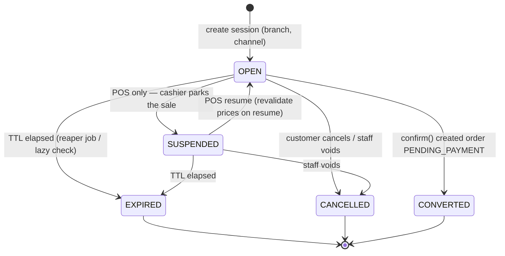
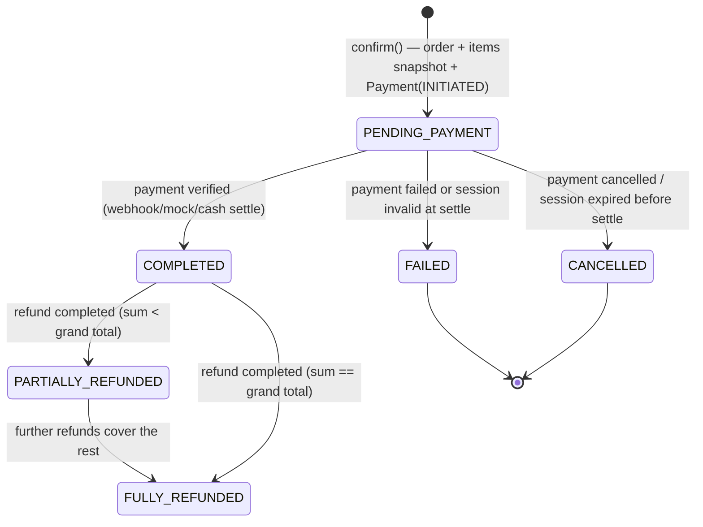
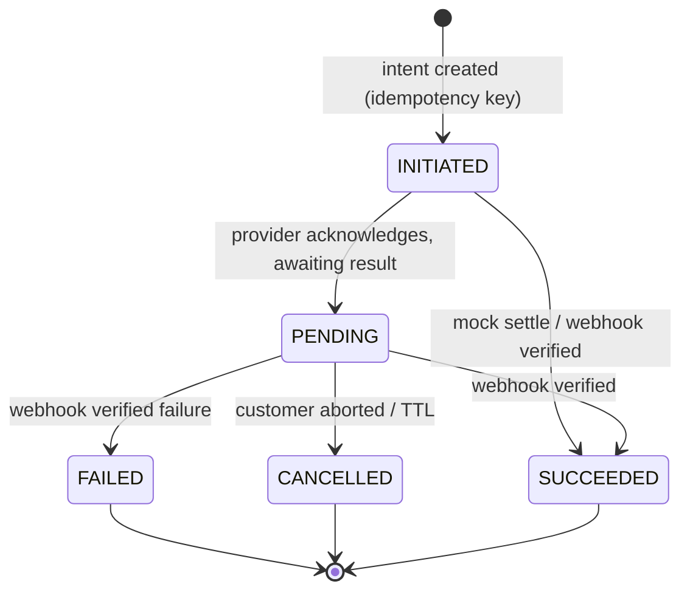
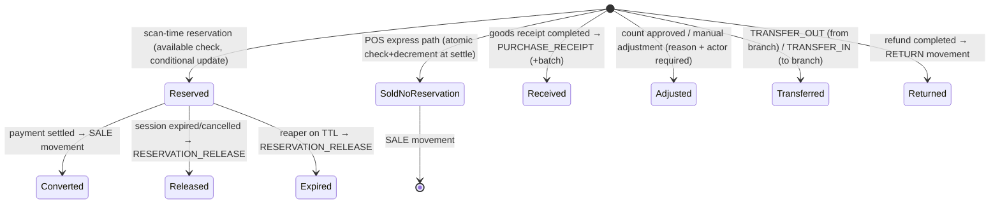

# State Transitions: Checkout → Order → Payment → Inventory

> Statuses live in `apps/api/prisma/schema.prisma` enums. These transitions are
> the contract the Phase 2–4 services implement; every allowed move below has a
> test obligation in its phase.

## 1. CheckoutSession

Rules:

- `SUSPENDED` is legal only for `channel = POS` (self-checkout sessions expire,
  they are never parked).
- Any transition out of `OPEN`/`SUSPENDED` releases all `ACTIVE`
  `StockReservation` rows (`RELEASED` + `RESERVATION_RELEASE` movements) inside
  the same transaction.
- Item mutations are allowed only while `OPEN` (or `SUSPENDED`→resume flow).
- Confirm on anything not `OPEN` returns a structured error — this is what makes
  double-click confirm / retried confirms no-ops.

## 2. Order

Rules:

- `PENDING_PAYMENT` orders are immutable snapshots; no price/item edits after
  creation — a changed cart means a new quote and a new confirmation.
- Only `COMPLETED` orders decrement stock (in the payment-settle transaction).
- `FAILED`/`CANCELLED` orders never touch the stock ledger; their reservations
  were already released when the session left `OPEN`.
- Refund transitions require role-gated approval (cashier requests, manager
  approves) before completion.

## 3. Payment

Rules:

- **The transition to `SUCCEEDED` is authoritative**: it happens only after
  server-side verification (webhook signature, mock settle token, or cash
  counted by the cashier). A frontend "success" flag does nothing by itself.
- Duplicate callbacks: if the payment is already `SUCCEEDED`, the handler
  returns 2xx without side effects (the unique `providerRef` + status check).
- The settle transaction also completes the order and decrements stock — see §4.

## 4. Inventory

Rules:

- `InventoryBalance.onHand - InventoryBalance.reserved` is "available". Every
  mutation of either column is a **conditional update** (`WHERE` guards against
  oversell), never a blind write.
- All changes append a `StockMovement` row in the same transaction; the ledger is
  immutable. Corrections create new entries with a reason and actor.
- Batch-consuming flows use **FEFO** (first-expiry-first-out) among non-expired
  batches when `InventoryBatch` rows exist for the product.
- `EXPIRED`/`RELEASED` reservations decrement `reserved` without touching
  `onHand` — the stock was never actually gone.
